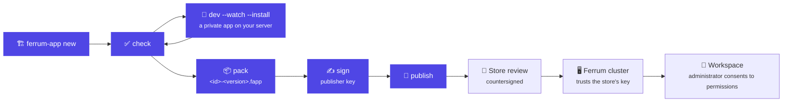
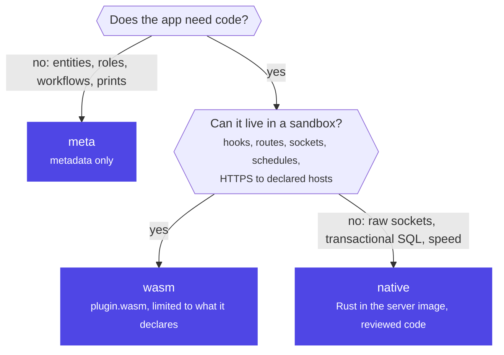
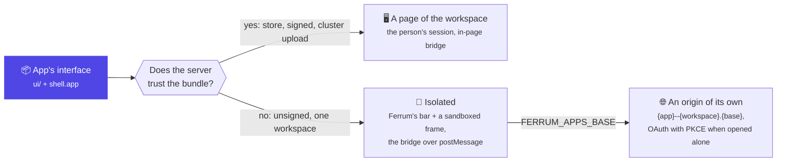
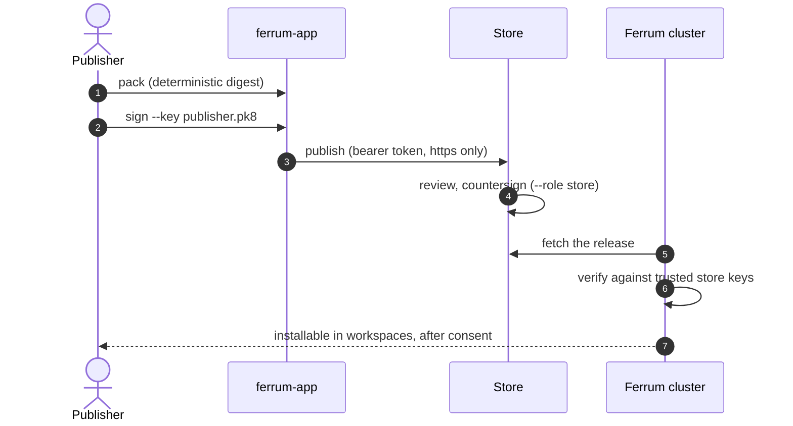

<div align="center">

<picture>
  <source media="(prefers-color-scheme: dark)" srcset="docs/assets/banner-dark.svg">
  
</picture>

[](https://github.com/CBFerrum/ferrum-sdk/actions/workflows/ci.yml)    

**Everything needed to build apps for [Ferrum](https://github.com/CBFerrum/Ferrum), the open-source, AI-first business platform.**

[What's inside](#whats-inside) · [Concepts](#concepts) · [Install](#install-the-cli) · [Quick start](#quick-start) · [Manifest](#manifest-reference-appyaml) · [Interfaces](#interfaces-of-their-own) · [Permissions](#permissions) · [Testing](#testing) · [Publishing](#signing-and-publishing) · [Commands](#command-reference)

</div>

---

## What's inside

| | |
|---|---|
| 🛠️ `cli/` | **`ferrum-app`**, the developer CLI: scaffold, check, pack, sign, verify, inspect, publish, dev |
| 🧩 `plugin-sdk/` | **`ferrum-plugin-sdk`**, the Rust guest SDK for WebAssembly plugins |
| 📐 `schemas/app.schema.json` | the JSON Schema of `app.yaml`, for editor validation |
| 🏗️ `templates/` | what `ferrum-app new` generates |
| 📚 `examples/` | `board` (screens and an extension point) and `customer-cards` (an interface of its own) |

The CLI reads and writes bundles with `ferrum-apps`, the same library the Ferrum server and the
store use: an app that passes `ferrum-app check` passes their checks too (the server
additionally validates against its own database: installed apps, existing entities).

> [!NOTE]
> The SDK is Apache-2.0 licensed, so apps built with it may use any license.

### An app's life



## Concepts

* **App**: what people install into a workspace from a store: CRM, a payment gateway, an EV
  charging integration, an industry kit. Identified by an `id`, versioned with semver, published
  by a **publisher**.
* **Runtime**: how an app runs.

  | Runtime | Code | Can do |
  |---|---|---|
  | `meta` | none, metadata only | entities, fields on existing entities, roles, menus, workflows, print formats, seed data |
  | `wasm` | a sandboxed WebAssembly module (`plugin.wasm`) | the above, plus hooks, HTTP routes, WebSockets, event subscriptions, schedules, HTTPS calls to declared hosts, all limited to what it declares |
  | `native` | Rust compiled into a Ferrum distribution | everything the platform can do; reserved for reviewed code |

* **Package**: Ferrum's metadata unit (`package.yaml`, `entities/*.yaml`, `sql/*.sql`,
  `print/<Entity>.html`). An app brings packages under `packages/<name>/`. A package that keeps
  people's data declares it in `package.yaml` so personal-data requests reach it:
  `personal_data: [{entity: Booking, match: guest_email, erase: [guest_name, guest_email, guest_phone]}]`
  (`match` is the email field naming the person; `erase` takes text, contact, date, JSON and table
  fields; an optional `where: {field: value}` narrows the records).
* **Bundle**: one release as a file, `<id>-<version>.fapp`: a gzip-compressed tar with
  `app.yaml`, docs, packages, `plugin.json` and `plugin.wasm` (wasm apps), images under
  `assets/`, and `SIGNATURES.json`.
* **Digest**: SHA-256 over the bundle's paths and file hashes, independent of tar order or
  timestamps. Signatures sign it.
* **Signatures**: Ed25519. Publishers sign their releases; the store countersigns after review.
  A Ferrum cluster installs store bundles only when a store key it trusts signed them.
* **Permissions**: what an app asks for (records it reads and writes, hosts it calls, public
  endpoints, sockets, schedules, events, new entities, changes to existing ones, roles, SQL).
  Administrators approve them when installing; an upgrade that asks for more waits for new
  consent.

### Which runtime?



## Install the CLI

```bash
cargo install --git https://github.com/CBFerrum/ferrum-sdk ferrum-app
```

For wasm apps also: `rustup target add wasm32-unknown-unknown`.

## Quick start

### 📄 A meta app (metadata only)

```bash
ferrum-app new notes-kit --runtime meta --publisher acme
cd notes-kit
ferrum-app check
ferrum-app dev --server http://127.0.0.1:5150 --token "$FERRUM_TOKEN" --watch --install
```

`new` creates `app.yaml`, `README.md` (the app's store page), `CHANGELOG.md`, `LICENSE` (MIT;
change it as you like), `.gitignore` and `packages/notes-kit/` with one entity (`NotesKitNote`)
and one role. `dev` packs the directory and uploads it to a server as a private app (an
administrator token is needed, and the server must allow uploads), again on every change with
`--watch`. Each upload is versioned `<version>-dev.<timestamp>` (the app and its packages, in the
uploaded copy only), so the server takes every change as a new release. With `--install` each
upload is also installed in the token's workspace (or updates it there), agreeing to its install
plan, so the change is live at once; without it, update the app on the Apps page to try it.

### 🖥️ An app with an interface of its own

```bash
ferrum-app new notes-board --runtime meta --ui --publisher acme
cd notes-board
ferrum-app dev --server http://127.0.0.1:5150 --token "$FERRUM_TOKEN" --watch --install
```

`--ui` adds `ui/`, the app's page at `/notes-board/` under the workspace's bar (`ui` and
`shell.app` in `app.yaml`): plain HTML, a module script and a stylesheet, no build step, talking
to Ferrum through the bridge `ui/ferrum.js`. The same files work everywhere the app may run: as a
page of the workspace when the server trusts the app (from a store, or uploaded to the cluster),
isolated in a sandboxed frame when it does not (an unsigned upload private to one workspace,
which carries no tables of its own: such an app reads and writes the platform's entities its
`access` names), or on an origin of its own. `examples/customer-cards` is a larger one.

For a native app, `--ui` makes a Vite, React and TypeScript interface built with Ferrum-Frontend's
packages from a checkout of Ferrum next to the app (`../../ferrum/web`; they are not on npm yet),
as Ferrum's own apps are. Its loop is hot reload against a real server: in `ui/`, `npm run dev`
starts Vite; on a Ferrum server run with `FERRUM_DEV_UI=1`,

```bash
ferrum-app dev --ui http://localhost:5173 --no-upload
```

serves the app's pages from it, behind the real session, bar and bootstrap, until `--ui off` or
the server restarts (an isolated interface stays isolated, framed from the dev server).
`npm run build` writes `ui/dist`, which the app's crate embeds; `npm run check` (CI) fails unless
`ui/dist` matches its sources and keeps the size budgets (entry JavaScript at most 200 KB
compressed, CSS 50 KB).

> [!TIP]
> A `shell.app` entry with `installable: true` asks to be installable on its own: browsers then
> offer the app, opening its route in a window of its own, beside the workspace as a whole
> (Ferrum's `docs/plugins.md`, "Installing").

### 🧩 A wasm app (sandboxed code)

```bash
ferrum-app new ev-charging --runtime wasm --publisher voltworks
cd ev-charging
cargo build --manifest-path plugin/Cargo.toml --release --target wasm32-unknown-unknown
cp plugin/target/wasm32-unknown-unknown/release/ev_charging_plugin.wasm plugin.wasm
ferrum-app check
```

Besides the meta files, `new` creates `plugin.json` (what the plugin receives and may do) and
`plugin/`, a Rust crate using `ferrum-plugin-sdk` with one hook that tidies note titles before
they are validated. `plugin/` is source only: bundles carry the compiled `plugin.wasm`.

```rust
use ferrum_plugin_sdk::{Request, Value, json, plugin};

plugin!(handle);

fn handle(req: Request) -> Value {
    match (req.kind(), req.str("stage")) {
        // Before a note is validated: collapse runs of spaces in its title.
        ("hook", "before_validate") => {
            let title = req.get("doc")["title"].as_str().unwrap_or_default();
            json!({"patch": {"title": title.split_whitespace().collect::<Vec<_>>().join(" ")}})
        }
        _ => json!({}),
    }
}
```

Inputs, replies and host calls (`data.*`, `kv.*`, `http.fetch`, `events.emit`, `sockets.*`,
`log`, `time.now`) are described in the Ferrum repository, `docs/plugins.md`. Any language that
compiles to a core WebAssembly module works; the module may import only `ferrum.host_call` and
must export `memory`, `ferrum_alloc` and `ferrum_hook`.

### ⚙️ A native app (platform code)

```bash
ferrum-app new crm --runtime native --publisher cbferrum
```

Native apps are Rust crates compiled into a Ferrum distribution, for first-party and reviewed
code that needs raw sockets, direct transactional SQL or speed. `new` scaffolds the manifest,
docs and packages; the crate (`ferrum-app-<id>`, with its `Cargo.toml` next to `app.yaml`)
depends on the platform crates by git tag, embeds `packages/` at compile time and exposes
`MANIFEST`, `packages()`, `register(&mut HookRegistry)`, `reports()` and
`maintenance(&Kernel)`; see [ferrum-app-crm](https://github.com/CBFerrum/ferrum-app-crm) for a
complete example. Its `DocHook`s take part in every document's life (`before_validate` …
`on_cancel`, actions) and may extend the platform's own actions with `after_action`
(Manufacturing Operations re-costs a BOM's operations when "Update Cost" re-costs its materials).
Rows an app keeps in another document's table (a work order's crew) are written with
`Kernel::set_child_rows_tx`; public endpoints throttle across replicas with `Kernel::rate_limit`.
The bundle a native app directory packs carries its manifest and packages for the store; the code
ships in the server image.

## Manifest reference (`app.yaml`)

| Field | Required | Rules |
|---|---|---|
| `id` | yes | `[a-z][a-z0-9-]{1,39}`, unique in the store |
| `name` | yes | one line, at most 60 characters |
| `version` | yes | semver, no build metadata (`1.4.0`, `2.0.0-beta.1`) |
| `publisher` | yes | your store publisher id (same syntax as `id`) |
| `summary` | yes | one line, at most 200 characters |
| `description` | | a markdown file in the bundle, usually `README.md` |
| `categories` | yes | 1 to 3 of: sales, crm, support, hr, finance, inventory, manufacturing, projects, commerce, pos, communication, productivity, marketing, analytics, integrations, localization, energy, iot, education, healthcare, industry, developer |
| `icon` | | an image under `assets/` (png, jpg, jpeg, gif, webp, svg) |
| `screenshots` | | up to 10 images under `assets/` |
| `license` | | SPDX expression, such as `Apache-2.0` |
| `homepage` | | an http(s) URL |
| `support` | | an http(s) URL or an e-mail address |
| `runtime` | yes | `native`, `wasm` or `meta` |
| `platform` | yes | semver requirement on the Ferrum app API, such as `">=0.3, <0.4"` (quote it: YAML reads a leading `>` as a block) |
| `requires` | | other apps: `{crm: "^1.2"}` |
| `packages` | meta: yes | directories under `packages/`; each directory's name is its package's name |
| `plugin` | wasm: yes | `plugin.json` (wasm apps only; the module is `plugin.wasm`) |
| `prefix` | see below | PascalCase, 2 to 8 letters or digits, not starting with `X` |
| `settings` | | `[{key, label, type, options?, required?, description?}]`; `key` snake_case and unique; `type` one of text, secret (write-only), number, check, select (select needs `options`) |
| `uninstall` | | `keep` (default) or `ask`: whether removing the app offers to delete its data |

> [!IMPORTANT]
> **Namespaces.** A wasm or meta app's entities start with its `prefix` followed by a capital
> letter or digit (`EvChargePoint`, not `Event`); its plugin's own entities (in `plugin.json`) are
> named `X<prefix>…` (`XEvSession`); fields it adds to other packages' entities start with the
> prefix in snake_case and `_` (`ev_`), which is also the only allowed `field_prefix`; its roles
> cannot grant `*` (all entities). Role names starting with `plugin:` are reserved. The store
> reserves each prefix for one publisher. Native apps are exempt.

**Code and SQL.** Meta apps carry no code: no `plugin.json`, no `plugin.wasm`, no `sql/`. SQL in
wasm or native apps runs with the application role under tenant isolation and is accepted by the
store only from verified publishers.

### Editor support

Point your editor's YAML support at the schema, for example with a first line in `app.yaml`:

```yaml
# yaml-language-server: $schema=https://raw.githubusercontent.com/CBFerrum/ferrum-sdk/main/schemas/app.schema.json
```

## Bundle layout and limits

```text
app.yaml                     required
README.md  CHANGELOG.md  LICENSE
plugin.json  plugin.wasm     wasm apps
packages/<name>/package.yaml
packages/<name>/README.md
packages/<name>/entities/*.yaml
packages/<name>/sql/*.sql
packages/<name>/print/<Entity>.html
assets/**/*.{png,jpg,jpeg,gif,webp,svg}
ui/**                        wasm and meta apps: screens
SIGNATURES.json              added by ferrum-app sign
```

Anything else is refused. Limits: 50 MiB unpacked, 2 000 files, 8 MiB `plugin.wasm`, 2 MiB per
text file. Text files are UTF-8; images must really be images; paths use letters, digits, `.`,
`_`, `-` and `/` only (no hidden files, no `..`, no links or devices). Screens under `ui/` may
hold `html`, `js`, `mjs`, `css`, `json`, `map`, `txt` and `svg` text, and `wasm`, `woff2` and
raster images up to 16 MiB each. `ferrum-app` builds the bundle from the app directory's root
files, `packages/`, `assets/` and `ui/` (hidden files skipped), so sources such as `plugin/`,
`target/` or `.git/` never end up in it. Packing is deterministic: the same files always give the
same `.fapp`.

## Screens and extension points

An app can bring screens (pages under `ui/`) and offer or use extension points. Ferrum's
`docs/plugins.md` ("Extension points and add-ons", "Screens") is the reference.

| Slot | Shows | Item |
|---|---|---|
| `ui.page` | a page with a sidebar entry | `title`, `entry`, `icon` |
| `ui.widget` | a card on Home | `title`, `entry`, `size: [w, h]` |
| `ui.panel` | a tab on the forms of an entity | `title`, `entry`, `entity` |
| `ui.settings` | the app's settings screen | `entry` |

Screens run sandboxed, with no network of their own. They talk to Ferrum through `ferrum.js`:
copy `examples/board/ui/ferrum.js` into your app's `ui/`. They can do what the app declared
(its plugin's permissions and its own entities), within the user's rights.

```js
import { ferrum } from "./ferrum.js";

const ctx = await ferrum.ready; // app, slot, user, locale, theme; record for panels
const { rows } = await ferrum.api("GET", "/api/v1/BdCard", { query: { limit: 20 } });
ferrum.toast(`${rows.length} cards`);
```

Scripts must be files: the screens' Content Security Policy allows no inline scripts. Forms
cannot be submitted, so use buttons. `examples/board` shows all of it: a page, a widget, a panel,
a settings screen and the `board.card` extension point.

## Interfaces of their own

An app may own a whole interface at addresses of its own (`ui` and `shell.app` in app.yaml; Ferrum's
`docs/plugins.md`, "Interfaces of their own"). An app the server trusts runs it on the workspace's
host with the person's session. An unsigned app uploaded to one workspace runs it **isolated**: its
pages are Ferrum's bar and a sandboxed frame with no session, no storage of the site and no network
but its own files, talking to Ferrum through `ferrum.js` (copy
`examples/customer-cards/ui/ferrum.js`), within what the app declared.



```js
import { ferrum } from "./ferrum.js";

const ctx = await ferrum.ready;                 // app, user, locale, theme, and path under the route
const { rows } = await ferrum.api("GET", "/api/v1/Customer", { query: { limit: 20 } });
ferrum.title("Customers");                      // the bar's and the tab's title
ferrum.started();                               // drawn: otherwise the platform offers a reload
ferrum.navigate("/?q=acme", { replace: true }); // the address bar follows the page
ferrum.on("location", ({ path }) => route(path)); // back and forward
const res = await ferrum.fetch("/api/v1/Customer?limit=1"); // straight to the API, with an app token
```

Where the server gives apps origins of their own (`FERRUM_APPS_BASE`), the frame holds
`{app}--{workspace}.{apps base}` instead: storage and workers of the app's own. Opened on its own
there, the page has no host, and `ferrum.js` signs in through the workspace (OAuth with PKCE),
keeps the session for the tab and makes the same calls itself, so the code above runs unchanged.
Refer to the interface's files by relative URLs: they sit at different paths in the two cases.

An app without a plugin declares what its pages may reach in app.yaml's `access`
(`[{entity: Customer, read: true}]`). `examples/customer-cards` is a complete example: an interface
with no build step that reads customers, follows the address bar, and shows how it is kept apart.

## Permissions

`ferrum-app inspect app.fapp` shows what installing asks for, the way the consent screen does:

```text
runs during: EvChargePoint validate
records: read Customer
calls host: api.ocpi.example
public endpoint: /ocpi/*
socket: /ocpp/* (public)
schedule: offline-sweep every 300 s
receives events: SalesInvoice.submitted
new entity: EvChargePoint
changes Customer: adds field ev_rfid
role: EV Operator
role EV Operator: write EvChargePoint
runs SQL: ev_charging/001_indexes.sql
```

Native apps also show `runs native code inside the server, with full access`. Each line comes
from `plugin.json` (`permissions`, `hooks`, `http_hosts`, public `routes`, `sockets`,
`schedules`, `subscriptions`, `entities`) or from the packages (entities, overlays, workflows,
seed data and print formats on other packages' entities, roles, SQL).

> [!WARNING]
> Ask for as little as you need: the permissions digest is recorded with the administrator's
> consent, and an upgrade that adds any line stops for a new consent. The plugin's `fuel_limit`
> is capped at 1 000 000 000 and `memory_limit_mb` at 256.

## Testing

| | |
|---|---|
| ✅ `ferrum-app check [dir]` | validates the manifest, the layout, every package, `plugin.json` (as the server parses it) and `plugin.wasm` (with the server's plugin validator) |
| 🔗 `ferrum-app check --platform-packages ../ferrum/packages` | also validates the app's packages together with the platform's, as the server's catalog does: links resolve, overlays apply, `plugin.json` names only existing entities, and a role that already exists on the platform is extended only with grants on the app's own entities (native apps may extend it freely) |
| 🔁 `ferrum-app dev --watch --install` | keeps a local workspace up to date while you work |
| ⚡ `ferrum-app dev --ui http://localhost:5173 --no-upload` | serves an installed app's pages from its interface's Vite server, with hot reload (a server run with `FERRUM_DEV_UI=1`; `--ui off` undoes it) |
| 🧪 Rust unit tests | plugin logic is ordinary Rust (`handle` takes a `Request` and returns JSON); `ferrum_plugins::PluginHost::execute` in the Ferrum repository runs a compiled module without a server |
| 🤖 `ferrum-app inspect --json` | the manifest, digest, signatures, permissions and files, for scripts and CI |

## Signing and publishing

```bash
ferrum-app keygen -o publisher.pk8            # prints publisher:<base64 public key>
ferrum-app pack -o ev-charging-1.4.0.fapp
ferrum-app sign ev-charging-1.4.0.fapp --key publisher.pk8
ferrum-app publish ev-charging-1.4.0.fapp --store https://store.example --token "$FERRUM_STORE_TOKEN"
```



* `keygen` writes an Ed25519 private key (PKCS#8 DER, mode 0600, never overwriting a file) and
  prints its public key as `publisher:<base64>`; register that with the store. With
  `--role store` it prints `store:<base64>`, the form clusters list in `apps.trusted_keys`. Keep
  private keys out of version control (the scaffolded `.gitignore` ignores `*.pk8`).
* `sign` adds a signature in place (`--role publisher` by default; stores sign with
  `--role store`). Signing again with the same key replaces its signature; a bundle changed
  after signing cannot be signed until its stale signatures are removed.
* `verify app.fapp --trust store:<base64> [publisher:<base64>...]` checks that the content
  matches the signed digest and that at least one trusted key signed it; every signature by a
  trusted key must be valid, others are ignored. Exit status 0 means verified.
* `publish` POSTs the bundle to `{store}/v1/releases` (`application/octet-stream`, bearer
  token) and prints the store's answer. Tokens can come from `FERRUM_STORE_TOKEN` (and
  `FERRUM_TOKEN` for `dev`) instead of the command line. Plain `http://` is refused except for
  localhost, and redirects are not followed, so tokens go only where you send them.

## Command reference

| Command | |
|---|---|
| `new <id> --runtime wasm\|meta\|native [--dir D] [--name N] [--publisher P] [--prefix X] [--ui]` | scaffold an app (`--ui`: with an interface of its own) |
| `check [dir] [--platform-packages DIR]` | validate an app directory |
| `pack [dir] [-o file.fapp] [--platform-packages DIR]` | check and build the bundle |
| `keygen -o key.pk8 [--role publisher\|store]` | create a signing key |
| `sign file.fapp --key key.pk8 [--role publisher\|store]` | sign a bundle in place |
| `verify file.fapp --trust ROLE:KEY...` | verify signatures |
| `inspect file.fapp [--json]` | manifest, digest, signatures, permissions |
| `publish file.fapp --store URL --token T` | submit to a store |
| `dev [dir] --server URL --token T [--watch] [--install] [--ui URL\|off] [--no-upload]` | upload to a server as a private app (multipart field `bundle` to `{server}/api/admin/apps/upload`); `--ui` serves its pages from a Vite server (`PUT`/`DELETE {server}/api/admin/apps/{id}/dev-ui`) |

## Building the SDK

The CLI depends on the platform crates `ferrum-apps`, `ferrum-meta` and `ferrum-plugins` from
[CBFerrum/Ferrum](https://github.com/CBFerrum/Ferrum) as git dependencies, so it installs with

```bash
cargo install --git https://github.com/CBFerrum/ferrum-sdk ferrum-app
```

To work on the SDK against a local platform checkout (`../ferrum`), add a git-ignored
`.cargo/config.toml`:

```toml
[patch."https://github.com/CBFerrum/Ferrum"]
ferrum-apps = { path = "../ferrum/crates/apps" }
ferrum-meta = { path = "../ferrum/crates/meta" }
ferrum-plugins = { path = "../ferrum/crates/plugins" }
ferrum-kernel = { path = "../ferrum/crates/kernel" }
```

`plugin-sdk/` is its own workspace, built for `wasm32-unknown-unknown` by the apps that use it;
scaffolded plugins depend on it from this repository by git.

## License

[Apache-2.0](LICENSE). Apps built with the SDK may use any license. Part of
[Ferrum](https://github.com/CBFerrum/Ferrum) · [Report an issue](https://github.com/CBFerrum/ferrum-sdk/issues)
